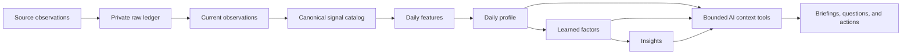

# Kairo health intelligence architecture

Kairo's HealthKit bridge is the first sensor family in a larger private life model. The model has six families: **Body**, **Mind**, **Attention**, **Work**, **Connection**, and **Story**. HealthKit mostly supplies Body and part of Mind. It must not be mistaken for the whole person.

## Five grains

1. **Source observation** — an immutable HealthKit sample or deletion with effective time, receipt time, source, device, metadata, and raw unit.
2. **Canonical signal** — a stable Kairo name, domain, aggregation rule, day-assignment rule, and interpretation for an Apple type identifier.
3. **Daily feature** — one statistic for one owner and personal day, such as sleep duration, resting-heart-rate mean, or workout minutes.
4. **Learned factor** — a versioned estimate of how a lagged feature predicts a declared target and horizon for this owner.
5. **Insight** — a bounded, evidence-backed statement with confidence, supporting days, caveats, and expiry.

Raw observations remain the replayable source of truth. Derived tables are disposable: their model version and source run make them safe to rebuild after the schema or logic changes.

## Time and identity rules

- Effective time describes when the event happened; receipt time describes when Kairo learned about it. Analyses use effective time and synchronization monitoring uses receipt time.
- A personal day uses the owner's IANA time zone, currently `Asia/Kolkata` by default.
- Sleep is assigned to the day of waking. Overlapping sleep sources are not added together; Kairo chooses the source with the greatest specific-stage coverage for that episode.
- Resynchronization can create multiple bridge-device rows for one HealthKit UUID. `health_current_observations` selects the newest received version per owner and sample UUID before feature calculation.
- Units remain traceable. A day containing conflicting units is marked suspect instead of silently combining them.

## Daily features and baselines

The first feature version, `health-v1`, builds daily summaries for mood, sleep, recovery, activity, workouts, body, respiratory, nutrition, and environment. It prefers Apple's daily summary samples where they exist; otherwise it uses the signal catalog's sum, average, minimum, maximum, latest, count, or duration rule.

Every numeric feature may have:

- its observed value and unit;
- source count and coverage;
- quality (`good`, `partial`, `suspect`, or `missing`);
- a trailing 28-day median and dispersion calculated from **prior days only**;
- a personal delta and robust z-score.

This within-person representation is more useful to Kairo than population thresholds. It distinguishes “high for Bhushan” from merely “high in general” and avoids using the target day to construct its own baseline.

## Mood ground truth and factor score `k`

Apple State of Mind entries are the declared target. Daily moods and momentary emotions remain separate events with valence, labels, associations, and effective time. Passive health signals are context or predictors, never a replacement for self-report.

Each factor is explicit about:

- target, such as next-morning valence or same-evening valence;
- horizon and lag;
- training period and sample size;
- coverage and stability across walk-forward folds;
- out-of-sample improvement over a personal-baseline model;
- model and feature version.

The comparable Kairo score is:

`k = direction × normalized out-of-sample gain × stability × sqrt(coverage)`

`k` ranks useful personal predictors; it is not a causal effect or a medical conclusion. A factor is withheld when mood labels, coverage, or temporal validation are insufficient.

## AI boundary

The assistant never receives a database connection or an unrestricted raw-health dump. It receives small owner-authenticated tools:

- `day` — one daily profile, mood events, coverage, relevant factors, and caveats;
- `trend` — a bounded feature series over a requested date range;
- `context` — a compact recent evidence packet and stored insights;
- `catalog` — definitions, units, domains, and aggregation semantics.

The model may summarize evidence, compare a day to the owner's baseline, ask a useful follow-up, or suggest a low-risk experiment. It may not diagnose, claim causality, invent missing measurements, or represent stale data as live.

## Operational flows

### Initial or corrected history

1. The iPhone uploads the replayable raw ledger.
2. Database migrations create the semantic and derived tables.
3. `npm run features:rebuild` rebuilds a bounded date range or the complete history.
4. `npm run factors:train` performs expanding-window, walk-forward evaluation against a personal-mean baseline.
5. Audit counts and quality flags are recorded in `health_feature_runs`.
6. The web and AI APIs read only completed, versioned results.

### Live changes

1. HealthKit wakes the iPhone when selected signals change, subject to iOS scheduling.
2. The bridge reconciles anchored changes and uploads them idempotently.
3. A small derived-feature job rebuilds affected personal days, including adjacent wake days for sleep.
4. Daily profile and factor evidence are refreshed.
5. Kairo can issue a briefing only when new evidence changes an actionable conclusion.

The current repository implements the full deterministic rebuild. Turning step 3 into an automatic post-ingest incremental job is the next reliability step.

## Safety and evidence

- Health data is sensitive and owner-scoped at every API boundary.
- Missingness and source conflicts are first-class data, not zeros.
- Prediction uses forward-only validation to prevent future leakage.
- Every insight must carry its evidence window, confidence, and model version.
- Health conclusions remain informational and must escalate urgent or clinical concerns to qualified care.

Primary semantics come from Apple's HealthKit documentation for statistics, sleep stages, State of Mind, provenance, and time zones, plus the FHIR distinction between effective and issued time. The longitudinal modelling rules are informed by research on within-person affect prediction and intensive longitudinal data; see the semantic-layer evidence register.
